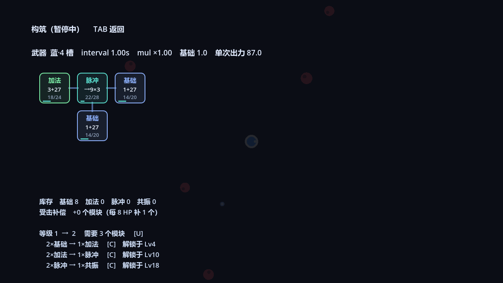

# Weapon Build Survivor

类《吸血鬼幸存者》的增量游戏：战斗靠走位与自动脉冲开火，成长靠**把模块插进武器电路板**。

模块既是数值也是弹药 —— 每开一次火就烧掉每个模块 1 次使用次数，用完就消失。所以「堆高数值」和「撑住消耗」是同一件事的两面。

## 当前状态

**M1 可玩切片已完成**，可以完整跑一局（无头 bot 自动对战稳定跑到 15 分钟 / 38 波）。

| 系统 | 状态 |
| --- | --- |
| 移动、敌人追击、受击反馈 | 完成 |
| 自动脉冲开火（射程内全体结算） | 完成 |
| 模块掉落、吸附、自动入槽 | 完成 |
| 电路板槽位（品质决定数量与连接方式） | 完成 |
| 模块网络（加法镜像、脉冲充能、共振加成） | 完成 |
| 合成、升级、配方解锁 | 完成 |
| 受击补偿（掉血换模块） | 完成 |
| 武器基础伤害 | 完成 |
| 精英怪 / 宝箱掉落新武器、多武器 | 未做 |
| 元游戏（工坊等级、跨局保留）、词条 | 未做 |
| 胜利结算（目前是无限刷） | 未做 |
| 音效、粒子、打击感 | 未做 |


## 核心循环

**战斗层**：走走位、别被围住。武器固定间隔自动开火，一次脉冲对射程内**所有**敌人各结算一次伤害；射程内没敌人就不开火、不消耗次数（清场间隙是喘息窗口）。

**构筑层**（TAB 暂停）：敌人死亡掉基础模块 → 插进电路板 → 提供数值 → 被开火烧掉 → 逼你重新插。多余的模块拿去合成（2 个同阶 → 1 个高阶）或升级（解锁配方）。

**为什么模块要有寿命**：如果模块永久，游戏就退化成「堆数字」。有了使用次数，短开火间隔 = 同样 DPS、双倍弹药消耗，开火间隔从手感参数变成弹药效率杠杆；而「这把枪现在打空了」是可以靠构筑调整解决的，不是运气。

三条防止死亡螺旋失控的保底：

- **无目标不开火** —— 清场间隙不烧弹药
- **武器基础伤害** —— 模块烧光时 DPS 不归零，还有 `基础伤害 / 间隔` 可以蹭
- **受击补偿** —— 每损失 8 HP 补 1 个模块（wave≥12 补加法，≥24 一次补 2 个），掉在脚边被吸走。弹药是负反馈，所以掉血必须反哺构筑，把死亡螺旋改造成「越危险越肥」的翻盘窗口

## 运行

需要 Godot 4.7+。仓库里不带引擎，自行下载便携版放到 `.tools/godot/`（该目录已 gitignore）。

```powershell
# 直接运行
.\.tools\godot\Godot_v4.7.2-stable_win64.exe --path .
```

Windows 下如果报 `Could not create directory: 'user://logs'`，先设 `$env:APPDATA = (Get-Location).Path + "\.tools\appdata"`；`Failed to read the root certificate store.` 是无害噪音，`2>$null` 掉即可。

## 操作

| 键 | 作用 |
| --- | --- |
| WASD / 方向键 | 移动 |
| TAB | 打开/关闭构筑界面（暂停游戏） |
| U | 升级（消耗库存模块，解锁合成配方） |
| C | 合成（2 个同阶库存 → 1 个高阶） |
| R | 重开 |

## 数值（宽松成长 v1）

完整推导与标定过程见 `docs/design.md` §2.5。

| 项 | 值 |
| --- | --- |
| 敌人 HP | `4 × 1.115^(wave−1)` |
| 刷怪速率 | `2.0 + 0.06 × wave` 个/秒 |
| 每杀掉落 | 0.65 个基础模块 |
| 波间隔 | 40 s |
| 开火间隔 / 射程 | 1.0 s / 260 px |
| 模块 | T1 基础 `1.0 / 20次` · T2 加法 `3.0 / 24` · T3 脉冲 `0 出力 + 每3s 喂 9.0 / 28` · T4 共振 `27.0 / 34` |
| 升级成本 | `3 × 1.18^(level−1)` 个模块 |
| 配方解锁 | T2 @ Lv4 · T3 @ Lv10 · T4 @ Lv18 |
| 武器品质 | 蓝 4 槽（T 型，基础 1.0）→ 12 波紫 5 槽（十字，1.5）→ 20 波金 6 槽（双排，2.0） |
| 受击补偿 | 每 8 HP → 1 个模块 |

### 模块网络规则

相邻 = 网格**曼哈顿距离 1**（上下左右，不含斜角）。网络加成只认**更低阶**的邻居，而且**不连锁传播**：读到的是邻居的「基础值 + 共振加成 + 脉冲加成」，不是邻居镜像后膨胀出来的数字。

| 模块 | 基础值 | 次数 | 网络效果 | 一句话 |
| --- | --- | --- | --- | --- |
| 基础 T1 | 1.0 | 20 | 无 | 原料，也是唯一能被镜像的底层 |
| 加法 T2 | 3.0 | 24 | 自身 + 每个**相邻**低阶模块的基础值 | 一个枢纽吃一圈原料 |
| 脉冲 T3 | 0（充能 9.0） | 28 | 每 3s 把 9.0 加到**所有相邻的主动模块**上，加成**永久留在对方身上** | 自己不产出，喂饱整圈邻居 |
| 共振 T4 | 27.0 | 34 | 每个**相邻的同阶（T4）** 模块 +50% 基础值，可被多个共振叠加 | 只加成自己人，越堆越强 |

#### 脉冲（T3）

- 自身输出 **0**：它的 9.0 全部给邻居。这样它和加法是两种东西，而不是「数值更大的加法」。
- 每 `3s` 一跳，给所有**相邻的主动模块**（基础/加法/共振，不含脉冲）各加 9.0。
- 加成是**永久写进对方的基础值**里的：所以加法会镜像到一个已经被喂肥的邻居，共振也会按加了成的基础值算 50%。这是脉冲最大的价值——它给的是「原料变肥」。
- 同一格最多叠 **9 跳**（+81.0），之后不再涨。
- 它自己不吃任何加成（脉冲不给脉冲喂）。
- 它**不占空槽**：板上没有两个以上主动模块时，脉冲只会躺在库存里，因为装上去等于净输出归零。

一字型 4 槽（T 型布局），摆 `加法 / 脉冲 / 基础 / 基础`，脉冲挨着这三个：

```
[加法 3.0] ─ [脉冲 →9×3] ─ [基础 1.0]
                  │
             [基础 1.0]
```

开火间隔 1s、忽略弹药消耗时，`3s` 一跳：

| 时间 | 加法 | 两个基础 | 单次出力（含武器基础 1.0） |
| --- | --- | --- | --- |
| 刚装好 | 3.0 | 1.0 | 6.0 |
| 1 跳 | 12.0 | 10.0 | 33.0 |
| 2 跳 | 21.0 | 19.0 | 60.0 |
| 3 跳 | 30.0 | 28.0 | 87.0 |

跳数越多越强，但模块寿命只有 20–28 次开火，所以实际能叠到 5–6 跳——脉冲是「开局弱、后面滚起来」的模块。
构筑屏里脉冲格显示 `→9×3`（每跳给几个邻居），邻居格显示 `3+27` 这种「自身 + 脉冲加成」的拆解。



#### 共振（T4）

- 只对**相邻的 T4** 生效。旁边是 T1/T2/T3 时，它不会给任何东西加成。
- 加成是「+50% 对方的基础值」。一个模块同时挨着两个共振就 +100%，挨三个就 +150%。
- 共振的加成**不会**被加法读到（加法只镜像更低阶），所以它是一条独立于镜像的堆叠路线。

两个相邻共振：各 `27 + 13.5 = 40.5`，合计 81（不共振时只有 54）。
一字排三个共振：中间 54、两端各 40.5，合计 135——中间那个同时被左右各加一次。

#### 同一块板上的收益对比（5 槽十字，中心 + 四臂）

| 装法 | 单次出力 | 说明 |
| --- | --- | --- |
| 5 × 基础 | 5.0 | 无网络效应，纯堆料 |
| 4 × 基础 + 中心加法 | 7.0 | 加法把四个臂收进来（各 1.0） |
| 4 × 加法 + 中心脉冲（刚放） | 48.0 | 脉冲给四臂各 +9 |
| 4 × 加法 + 中心脉冲（3 跳后） | 96.0 | 四臂各 +27 |
| 5 × 共振 | 243.0 | 中心 81、四臂各 40.5；T4 的收益来自彼此挨着 |

十字布局里四个臂互不相邻，所以加法只能吃到中心那一格——这就是为什么加法要摆成「枢纽 + 一圈原料」，脉冲要摆成「中心喂四周」。

这也是为什么 T4 要到 Lv18 才解锁：它不是一个模块的强度，而是**布局密度**的强度。

## 目录

```
docs/design.md        设计文档（三层循环、弹药经济、数值标定过程与结论）
tasks/plan.md         实现计划与里程碑
scenes/main.tscn      主场景
scripts/game.gd       主控：刷怪 / 开火 / 掉落 / 构筑 / HUD / 平衡自测台
scripts/player.gd     玩家移动
scripts/enemy.gd      敌人追击与受击表现
scripts/pickup.gd     模块掉落与吸附
sim/economy_sim.gd    M0 无头经济模拟（纯数学，不含战斗，用于标定数值）
```

## 开发工具

自测台写在 `scripts/game.gd` 里，通过命令行参数触发（`--` 之后的参数走 `OS.get_cmdline_user_args()`）：

```powershell
# 无头自动对战：bot 每 0.5s 决策一次（每 3 次优先升级，其余优先合成），8 倍速
.\.tools\godot\Godot_v4.7.2-stable_win64_console.exe --headless --path . -- playtest bot pt=1500
# 输出每 5s 一行：t/w/hp/dps/need/drop/burn/lvl/slot/kills

# 截图：ff 先用 8 倍速把局面推到指定秒数，shotat 是拍图时刻，shotbuild 先开构筑屏
.\.tools\godot\Godot_v4.7.2-stable_win64_console.exe --path . --resolution 1280x720 -- `
  "shot=G:/tmp/a.png" "shotat=470" shotbuild shotbot ff=465
```

`need = 刷怪率 × 当前波 HP` 是**聚合模型**的参考值，只在单目标武器下准确；现在开火是范围脉冲，bot 实际能压住的量远高于这个数，看它只为找相对趋势。

### 电路板规则自检

`-- boardtest` 会摆一块固定的板（加法 / 脉冲 / 基础 / 基础），把 `interval` 设成 999 排除弹药消耗，每 0.5 秒打印整板出力与每个模块的脉冲加成：

```powershell
.\.tools\godot\Godot_v4.7.2-stable_win64_console.exe --headless --path . -- boardtest
# t= 3.1  out=[12.0, 0.0, 10.0, 10.0]  power= 33.0  bonus=[9.0, 0.0, 9.0, 9.0]
# t= 6.2  out=[21.0, 0.0, 19.0, 19.0]  power= 60.0  bonus=[18.0, 0.0, 18.0, 18.0]
# t= 9.3  out=[30.0, 0.0, 28.0, 28.0]  power= 87.0  bonus=[27.0, 0.0, 27.0, 27.0]
```

`-- demoboard` 是同一块板但保留 `interval 1.0`，用来拍构筑屏截图（上面那张脉冲图就是它拍的）。

GDScript 报 `Parse Error` 时 Godot 只往 stderr 打一行、然后像没事一样退出；排查时**别加 `2>$null`**，否则只能看到「什么都没发生」。

## 已知问题

- 敌人没有寻路，直线冲脸，会互相重叠成一条线
- 摄像机跟随有平滑，但屏幕外敌人不会做剔除，靠 `MAX_ENEMIES = 240` 硬cap
- 构筑屏是固定布局，UI 缩放没做适配（只验证过 1280×720）
