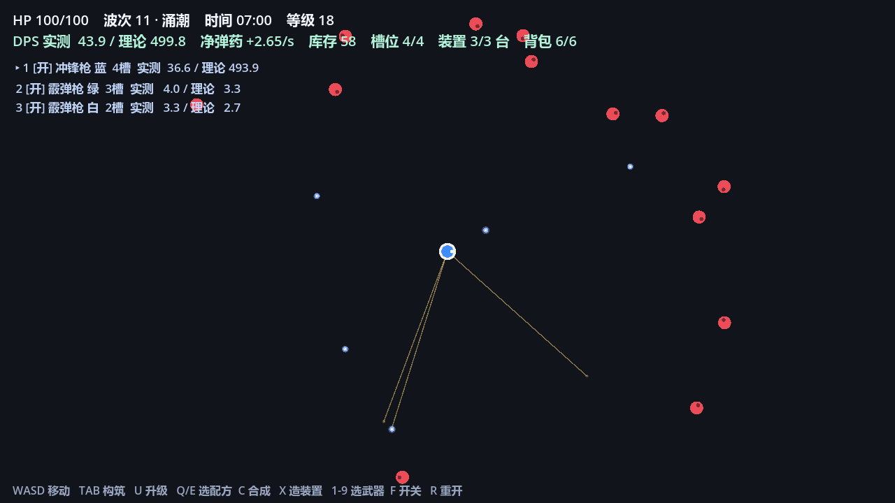
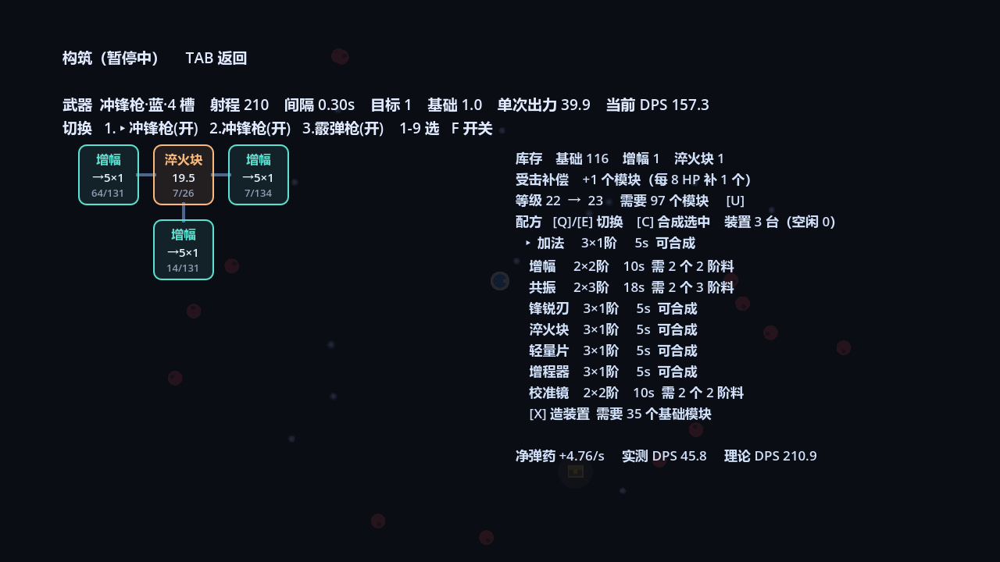
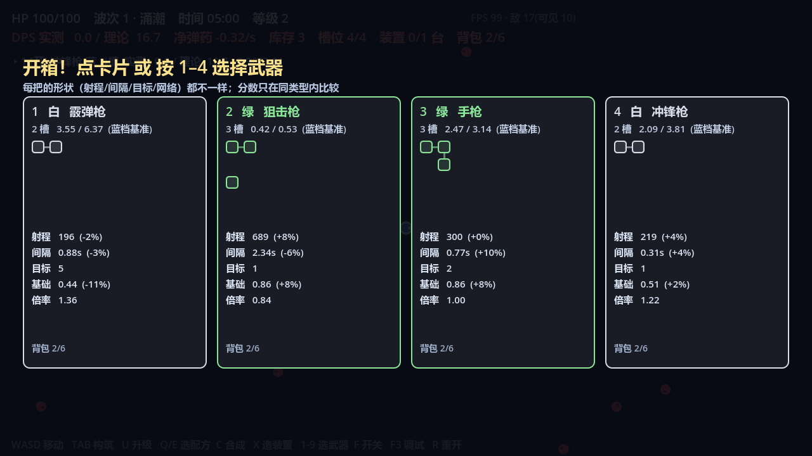

# Weapon Build Survivor

类《吸血鬼幸存者》的增量游戏：战斗靠走位与**搜寻目标自动开火**，成长靠**把模块插进武器的电路板**。

模块既是数值也是弹药 —— 每开一次火就烧掉每个模块 1 次使用次数，用完就消失。所以「堆高数值」和「撑住消耗」是同一件事的两面。

> 方案 v4（开发控制台、左下角升级按钮、重装变种 brute、同屏 400 + 集中渲染、波次主导+陪衬、精英冲刺锁向、配方改由升级奖励解锁）已全部实现，过程与实测见 [`docs/plan-v4.md`](docs/plan-v4.md) 与 [`docs/testlog.md`](docs/testlog.md)。下面描述的是当前代码的实际状态。

## 当前状态

可完整跑一局：无头 bot 自动对战能稳定跑到 900 秒 / 23 波以上。

| 系统 | 状态 |
| --- | --- |
| 移动、敌人追击、受击反馈、击退、脱战回血 | 完成 |
| 5 种敌人（涌潮 / 疾行者 / 磐石 / 射手 / 冲刺精英）+ 重装变种 brute + 5 套波次编成（每波主导 + 三种陪衬）+ 4 种生成编队（单点 / 一团 / 弧线 / 一整圈） | 完成 |
| 冲刺精英（蓄力红线 → 冲刺 → 硬直）与远程射手（子弹 + 无敌帧） | 完成 |
| 搜寻目标自动开火（最近 N 个目标 / 镭射锁最高血量 / 狙击优先射手和精英 + 拖尾弹道） | 完成 |
| 8 把武器：手枪 / 冲锋枪 / 霰弹枪 / 狙击枪 / 镭射 / 榴弹炮 / 环绕刃 / 激光环 | 完成 |
| 多武器并行开火、左侧武器栏（最多 6 行 + F3 看全部）、逐把开关 | 完成 |
| 模块掉落、吸附、自动入槽（模块永远装进「当前选中」的那把） | 完成 |
| 电路板槽位（品质决定数量，**布局随机生成**：基础网络积木 + 旋转镜像 + 密堆/留缝） | 完成 |
| 模块网络（加法镜像、增幅加成、共振加成、不做连锁传播） | 完成 |
| 20 个模块 / 20 个配方（含 6 个武器特化件；全部靠升级四选一第 4 张解锁） | 完成 |
| 合成装置（可反复制造，并行合成位） | 完成 |
| 升级四选一（3 buff + 1 配方卡；第 4 张是「解锁配方」或满池后的模块礼包，T 换牌）、14 个 buff | 完成 |
| 宝箱 4 选 1（品质 / 数值 / 迷你电路板预览；背包满走替换界面） | 完成 |
| 武器数值随机化（同类型内分值归一化，`rolltest` 自检 0 倒挂） | 完成 |
| 调试 HUD（FPS / 敌人数 / 需求比 / `F3` 面板 / `seed=` 复现） | 完成 |
| 构筑屏鼠标交互（拖拽摆放 / 交换 / 回收区 / 落点出力预览 / ESC 返回 / × 关闭） | 完成 |
| 合成装置指派配方（每台一行进度条、选配方、取消全额返还、自动开关） | 完成 |
| 重装变种 brute（flood/rock/shooter 模板，只把血量 ×8，单发最多打掉 20% 血） | 完成 |
| 开发控制台（`` ` `` / `F1` 开，14 条命令，暂停来源集合） | 完成 |
| 左下角升级按钮（金呼吸 + 红点 / 灰态进度 / 失败抖一下） | 完成 |
| 元游戏（工坊等级、跨局保留）、词条 | 未做 |
| 胜利结算（目前是无限刷） | 未做 |
| 音效、粒子、打击感 | 未做 |
| 经济过松：后期库存堆到 400+ 基础模块用不掉 | 待调 |







## 核心循环

**战斗层**：走位、别被围住。每把启用的武器按自己的间隔自动开火，开火时**搜寻射程内最近的 N 个目标**各结算一次伤害；射程内没目标就不开火、不消耗次数。

**构筑层**（TAB 暂停）：敌人死亡掉基础模块 → 插进电路板 → 提供数值 → 被开火烧掉 → 逼你重新插。多余的模块拿去合成（2 个同阶 → 1 个高阶）或升级（解锁配方）。

**为什么模块要有寿命**：如果模块永久，游戏就退化成「堆数字」。有了使用次数，短开火间隔 = 同样 DPS、双倍弹药消耗，开火间隔从手感参数变成弹药效率杠杆。

三条防止死亡螺旋失控的保底：

- **无目标不开火** —— 清场间隙不烧弹药
- **武器基础伤害** —— 模块烧光时 DPS 不归零，还有 `基础伤害 / 间隔` 可以蹭
- **受击补偿** —— 每损失 8 HP 补 1 个模块，掉在脚边被吸走（wave≥12 给加法，≥24 一次给 2 个）。弹药是负反馈，所以掉血必须反哺构筑

## 运行

需要 Godot 4.7+。仓库里不带引擎，自行下载便携版放到 `.tools/godot/`（该目录已 gitignore）。

```powershell
# 直接运行
.\.tools\godot\Godot_v4.7.2-stable_win64.exe --path .
```

Windows 下如果报 `Could not create directory: 'user://logs'`，先设 `$env:APPDATA = (Get-Location).Path + "\.tools\appdata"`；`Failed to read the root certificate store.` 是无害噪音，`2>$null` 掉即可。

## 操作

| 键 | 作用 |
| --- | --- |
| WASD / 方向键 | 移动 |
| TAB | 打开/关闭构筑界面（暂停游戏） |
| 1–9 | 选中左侧武器栏里的第 N 把（构筑屏编辑的就是它） |
| 鼠标拖动 | 构筑屏里把库存模块拖到电路板格子 = 摆放（落点会显示整板出力变化）；拖到另一格 = 交换；拖到左下角回收区 / 右键 = 卸下 |
| F | 开 / 关当前武器 |
| F3 | 调试面板（FPS、敌人总数/可见数、刷怪率、需求比、种子） |
| U / 左下角「↑ 升级」 | 升级（消耗库存模块）：金呼吸 + 红点表示可升，灰态显示 `2 / 3` 进度；成功后连升会继续亮 |
| `` ` `` 或 `F1` | 开发控制台（`Esc` 关；14 条命令见下） |
| Q / E | 构筑屏里翻配方（20 个配方分页显示） |
| C | 把当前选中的配方塞进空闲合成装置 |
| V / B | 快捷合成「增幅 / 共振」 |
| X | 造一台合成装置（吃基础模块） |
| 装置页「选配方」 | 给某一台装置指定要合成的配方（只列已解锁且材料够的），「取消」全额退还材料 |
| 1–4 / 空格 / 回车 | 升级四选一时选卡 |
| T | 把配方卡换成第 4 张 buff（每级一次） |
| R | 重开 |

## 数值（当前代码）

| 项 | 值 |
| --- | --- |
| 敌人 HP | `1.80 × 1.118^(wave−1)`，12 波后额外 `×1.045^(wave−12)`，再乘该敌人的血量倍率 |
| 刷怪速率 | `1.20 × 1.19^wave × 编成系数`，上限 `基础值 × 1.8` |
| 生成半径 | 1200–1400（一定在屏幕外，敌人从四面走进来） |
| 镜头 | zoom 0.62（关掉 position_smoothing：Godot 4.7 里和 zoom 同开会算出 NaN 导致整屏消失） |
| 每杀掉落 | 0.30 个基础模块 × 该敌人血量倍率 ÷ 本波平均倍率 |
| 波间隔 | 40 s |
| 同屏上限 | 400 只（重装变种另算，最多 +50 = 450） |
| 接触伤害 | 2.2 / 秒 / 只（最多同时 6 只结算） |
| 模块 | 基础 `1.0 / 45次` · 加法 `3.0 / 60` · 增幅 `0 出力 + 5.0 / 120` · 共振 `27.0 / 100` |
| 配方 | `2×基础 → 加法 3s` · `2×基础 → 增幅 8s` · `2×增幅 → 共振 14s` |
| 配方解锁 | 开局全部锁着；升级四选一的第 4 张「配方 · X（解锁）」逐个解锁（同一配方不重复出现；20 个全解锁后第 4 张变模块礼包） |
| 升级成本 | `3 × 1.18^(level−1)` 个模块 |
| 武器品质 | 开局蓝 4 槽 → 12 波紫 5 槽 → 20 波金 6 槽；品质基础伤害 `0.5 / 0.8 / 1.0 / 1.5 / 2.0` |
| 合成装置 | 可反复制造，第 n 台造价 `12 × 1.7^(n−2)` 个基础模块，上限 8 台，开局免费 1 台 |
| 升级四选一 | 3 张 buff（攻击/经济/生存各一）+ 1 张配方卡，14 个 buff 各自有上限层数 |
| 宝箱 | 4 把武器任选 / 品质权重按波次 / 背包满 6 时进入「替换」界面 |
| 武器数值 | 同类型内按分值归一化（`QM = 0.55/0.75/1.00/1.35/1.80`），逐项 ±8%~±20% 浮动，`mul` 吸收误差 |
| 受击补偿 | 每 8 HP → 1 个模块 |
| 宝箱 | 精英 50% · 每波 1 个 · 90 秒保底 · 45 秒消失 · 同屏最多 3 个 |

> 已按「数量优先」调过：敌人变多、单个变脆（血量基数 4 → 1.8，刷怪量约 ×1.7），总血量压力基本不变，但屏幕上的人明显变多。

## 武器

| 武器 | 射程 | 间隔 | 目标数 | 单发倍率 | 基础伤害 | 定位 |
| --- | --- | --- | --- | --- | --- | --- |
| 手枪 | 300 | 0.70s | 2 | 1.00 | 1.0 | 开局基准 |
| 冲锋枪 | 210 | 0.30s | 1 | 1.10 | 0.5 | 弹药黑洞，专治快脆 |
| 霰弹枪 | 200 | 0.90s | 5 | 1.11 | 0.8 | 清堆积 |
| 狙击枪 | 640 | 2.50s | 1 | 1.00 | 3.0 | 长射程点名厚血（只从宝箱出） |
| 激光环 | 420 | 40.0s | 全范围 | 4.00 | 2.0 | 每 40 秒的清场核弹 |

多目标折扣：`每目标伤害 = 单次出力 × (1 + 0.10 × (命中数−1)) / 命中数`。

## 敌人

| 种类 | 速度 | 血量倍率 | 半径 | 说明 |
| --- | --- | --- | --- | --- |
| 涌潮 flood | 100 | 1.00 | 13 | 基准怪 |
| 疾行者 runner | 205 | 0.34 | 9 | 快而脆，橙色尖头 |
| 磐石 rock | 52 | 2.67 | 19 | 慢而厚，带硬壳 |
| 射手 shooter | 70 | 1.71 | 12 | 保持 140–190 距离放风筝，每 3.2s 一发 5 伤子弹 |
| 冲刺精英 charger | 78 | 9.00（手设） | 20 | 蓄力 0.9s 红线跟随 → 锁向 + 0.15s 预备帧（实线 + 端点圆点）→ 780px/s 冲刺 0.35s 按线段判定 → 24 伤 + 击退 → 硬直 1.1s |
| 重装变种 brute | 同模板 | 模板 × 8 | 同模板 | 从 flood / rock / shooter 里抽模板，**只放大血量**（速度/半径/伤害不变），近白描边区分；单发最多打掉 20% 血（≥5 发）；wave≥3 起每 20s 刷 2–4 只，同屏上限 50，可超编绕过 400 |

波次编成每 5 波循环：涌潮 / 混编 / 疾行 / 磐石 / 混编，用预算系数把每波总血量拉平，所以差别体现在**密度与速度**上。每波都是「主导 + 三种陪衬」的洗牌序列（涌潮 flood 70% / 疾行 runner 65% / 磐石 rock 60% / 混编 flood 40%），每 6 只至少 1 只非主导，不会整波只有一种怪。

## 模块网络规则

相邻 = 网格**曼哈顿距离 1**（上下左右，不含斜角）。结算顺序是固定的：**共振 → 加法镜像 → 增幅加成**，且镜像**不连锁传播**。

| 模块 | 基础值 | 次数 | 网络效果 |
| --- | --- | --- | --- |
| 基础 T1 | 1.0 | 45 | 无。原料，也是唯一能被镜像的底层 |
| 加法 T2 | 3.0 | 60 | 自身 + 每个**相邻低阶**模块的基础值 |
| 增幅 T3 | 0 | 120 | 自身不出力，把 **5.0** 加到**所有相邻非增幅模块的最终输出**上 |
| 共振 T4 | 27.0 | 100 | 每个**相邻同阶（T4）**模块 +50% 基础值，可被多个共振叠加 |

- 加法的镜像是「读数」，被镜像的模块自己不会因此变强；不连锁，所以不会指数爆炸。
- 增幅加在**最终输出**上，不会被加法镜像放大 —— 这是它和「数值更大的加法」的区别；放在枢纽位最值钱。
- 共振只认 T4 邻居，加成不回流给加法（加法只镜像更低阶），是一条独立的堆叠路线。
- 增幅没有邻居时出力为 0，所以自动装填（`_install`）只有在「换上去整板出力严格变高」时才动手。

## 目录

```
docs/design.md        设计文档（三层循环、弹药经济、数值标定过程与结论）
docs/plan-v2.md       可玩性扩展方案（v2.4，含待拍板项）
tasks/plan.md         实现计划与里程碑
scenes/main.tscn      主场景
scripts/game.gd       主控：刷怪 / 开火 / 掉落 / 构筑 / 宝箱 / HUD / 自测台
scripts/player.gd     玩家移动、击退、无敌帧
scripts/enemy.gd      敌人状态机（追击 / 放风筝 / 蓄力冲刺）
scripts/bullet.gd     射手子弹
scripts/chest.gd      宝箱
scripts/pickup.gd     模块掉落与吸附
sim/economy_sim.gd    M0 无头经济模拟（纯数学，用于标定数值）
```

## 开发工具

自测台写在 `scripts/game.gd` 里，通过命令行参数触发（`--` 之后的参数走 `OS.get_cmdline_user_args()`）：

```powershell
# 无头自动对战：bot 每 0.5s 决策一次，8 倍速
.\.tools\godot\Godot_v4.7.2-stable_win64_console.exe --headless --path . -- playtest bot pt=900
# 输出每 5s 一行：t/w/hp/dps/need/drop/burn/lvl/slot/dev/板面/kills/伤害来源/alive

# 截图：ff 先用 8 倍速把局面推到指定秒数，shotat 是拍图时刻，shotbuild 先开构筑屏
.\.tools\godot\Godot_v4.7.2-stable_win64_console.exe --path . --resolution 1280x720 -- `
  "shot=G:/tmp/a.png" "shotat=705" shotbuild shotbot ff=700
```

> 用 `cheat=...wave=N` 跳波时，第 0 帧的 `elapsed` 就已经是 `(N-1)×40`，`shotat` 必须大于这个值，否则会在开局立刻截图（面板空白）。

### 开发控制台（游戏内）

`` ` `` 或 `F1` 打开下方面板（`Esc` 关闭）；`↑`/`↓` 翻 50 条历史，`Tab` 补全命令名与模块 id，`;` 分隔批量命令；未知命令红字并给编辑距离 ≤2 的提示。14 条命令：

```text
help [命令] · speed <0.25–8> · level <n>|+n · wave <n> · restart
weapon <id> [品质1–5] · give <模块id> <数量> · device [台数] · god · hp <数值>
kill · spawn <种类> <数量> · fps · clear
```

暂停改成「来源集合」（构筑 / 选卡 / 控制台），任何一个开着都暂停，全关了才恢复；`F5–F9` 旧热键已删除，命令行 `cheat=` 走同一套命令函数。

`need = 刷怪率 × 当前波 HP × 本波平均血量倍率` 是**聚合模型**的参考值，只看相对趋势。

### 电路板规则自检

`-- boardtest` 摆一块固定的金 6 槽 2×3 密堆板（共振 / 共振 / 增幅 / 基础 / 加法 / 基础），把 `interval` 设成 999 排除弹药消耗，每 0.5 秒打印整板出力：

```powershell
.\.tools\godot\Godot_v4.7.2-stable_win64_console.exe --headless --path . -- boardtest
# 期望 out=[40.5, 45.5, 0.0, 1.0, 5.0, 6.0]  power=100.0
```

`-- demoboard` 是同一块板但保留 `interval 1.0`，用来拍构筑屏截图。

GDScript 报 `Parse Error` 时 Godot 只往 stderr 打一行、然后像没事一样退出；排查时**别加 `2>$null`**，否则只能看到「什么都没发生」。固定流程：先 `--headless --path . --check-only --script res://scripts/game.gd 2>&1 | Select-String "Parse Error"`，再跑 playtest。

## 已知问题

- 敌人没有寻路，直线冲脸，会互相重叠成一条线
- 屏幕外敌人不做剔除，靠 `MAX_ENEMIES = 400` 硬 cap（重装变种可超编到 450）
- 重装变种抽到 shooter 模板时会风筝，和「拦路」定位相反（先留池观察）
- 背包不限容量：一局能捡到十几把武器，左侧武器栏会占掉半屏（方案 v2.4 待拍板）
- 宝箱品质会被波次基线统一覆盖，最后清一色紫 5 槽（同上）
- 构筑屏是固定布局，UI 缩放没做适配（只验证过 1280×720）
- 激光环的「全场」判定已经能用（`targets = -1`），但视觉还是普通弹道，没有环状冲击波
